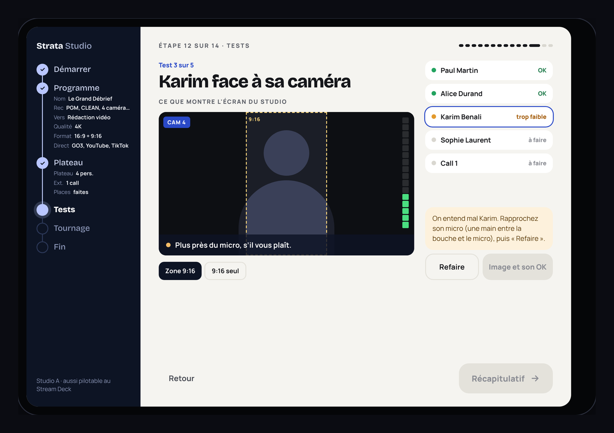
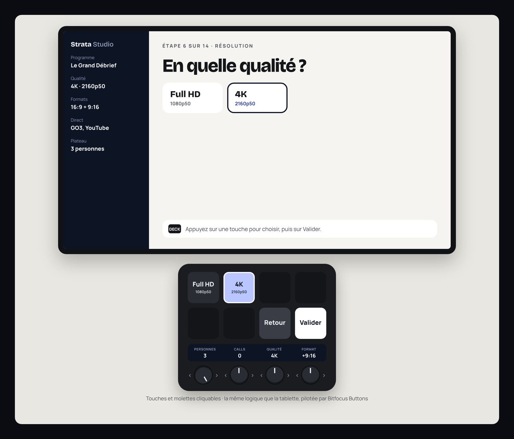
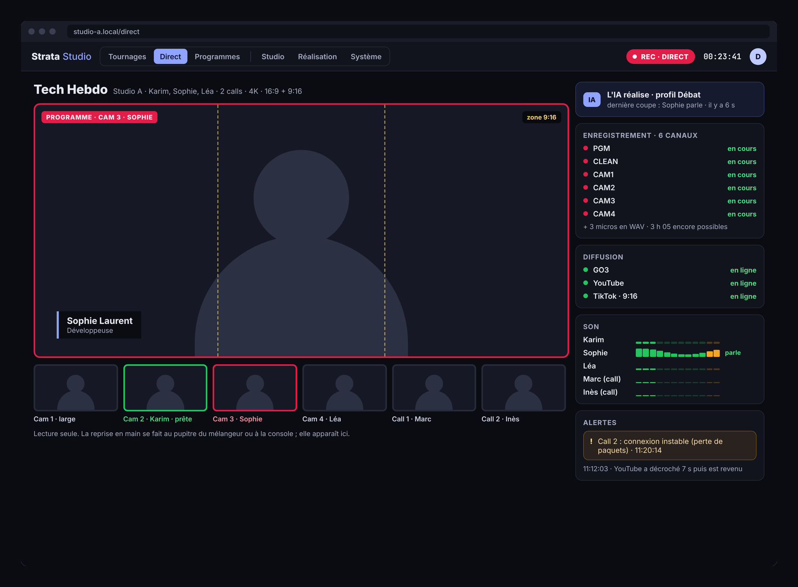
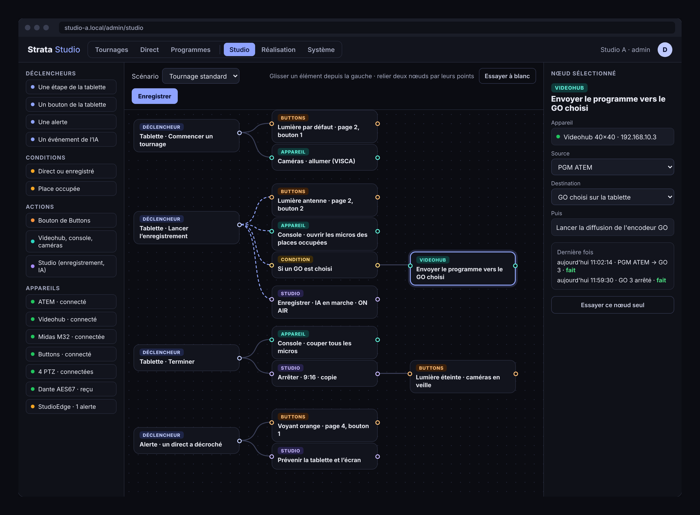
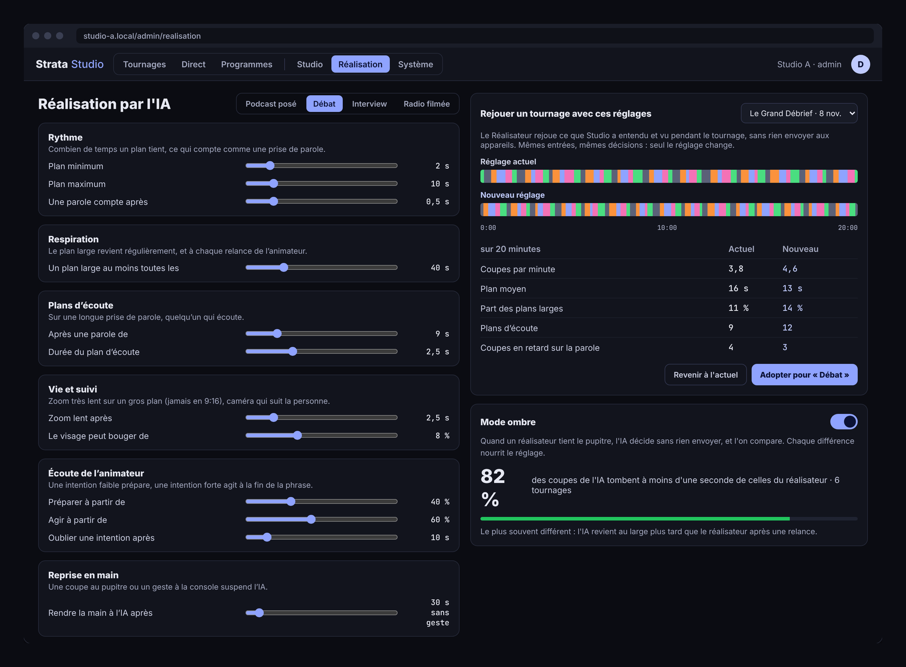

# Strata Studio

**Le studio autonome.** Strata Studio automatise un studio de podcast ou de radio filmée. Un journaliste prépare et lance son émission depuis une tablette. Une IA locale commute le mélangeur (ATEM ou vMix) et cadre les caméras PTZ (Sony FR7, BRC-AM7). Un réalisateur peut reprendre la main à tout moment.

Studio est un système de contrôle. Il pilote le nodal (Videohub en SDI, NMOS IS-05 en ST 2110, routage NDI), le mélangeur, les caméras et la console audio (Midas M32, Yamaha DM5). Il passe par Bitfocus Buttons pour la lumière et les automations. Aucune image ne passe par lui.

Strata Studio fait partie de la galaxie Strata, avec Strata Graphics et Strata Multiview.

> État : **étape 0**. Le Réalisateur, l'enregistrement et les pilotes tournent sur un studio simulé ; les pilotes restent à essayer sur le vrai matériel. Les interfaces (téléphone, iPad, Stream Deck, pages web) existent en **maquettes interactives**, pas encore dans le serveur. Les fonctionnalités sont dans [`docs/FONCTIONNALITES.md`](docs/FONCTIONNALITES.md), l'architecture dans [`docs/PROPOSITION.md`](docs/PROPOSITION.md).

## Aperçu

Les captures ci-dessous viennent des maquettes interactives. Elles montrent les écrans prévus ; le serveur ne les sert pas encore.

**Le tournage au téléphone** : accueil, vérification du studio, placement, tests un par un, tournage.


**Le même parcours sur l'iPad** : pendant les tests, l'écran du studio montre la zone 9:16, le vumètre et la consigne.



**Au Stream Deck +**, avec l'écran du studio :



**Les pages web.** Un tournage : la frise des plans, qui parle, ce que l'IA a décidé, les fichiers et les exports de montage.


Le direct, en lecture seule :



**L'administration.** Le studio en nœuds, relié à Bitfocus Buttons :



Le réglage de l'IA, le rejeu d'un tournage et le mode ombre :



## Installer sur Ubuntu

Pour Ubuntu Server **22.04 LTS** ou **24.04 LTS**, en 64 bits (amd64). Chaque [release](https://github.com/DamienP2/Strata-Studio/releases) fournit le paquet `.deb`, une archive des exécutables et leurs sommes SHA-256.

### 1. Préparer la machine

Une installation minimale d'Ubuntu Server suffit. Donnez-lui une adresse fixe sur le réseau de la régie, celui où sont le mélangeur, le Videohub, les caméras et la console. Si les micros arrivent en AES67, il faut aussi une carte sur le réseau Dante.

```bash
sudo apt update && sudo apt full-upgrade -y
```

### 2. Télécharger le paquet

```bash
wget https://github.com/DamienP2/Strata-Studio/releases/download/v0.1.0/strata-studio_0.1.0_amd64.deb
```

Pour vérifier le fichier, comparez sa somme avec celle du fichier `SHA256SUMS` de la release :

```bash
sha256sum strata-studio_0.1.0_amd64.deb
```

### 3. Installer

```bash
sudo apt install ./strata-studio_0.1.0_amd64.deb
```

`apt` installe aussi ffmpeg. Le paquet crée :

- le compte de service `strata-studio` ;
- le dossier des tournages `/var/lib/strata-studio/enregistrements` ;
- les réglages `/etc/strata-studio/strata-studio.env` ;
- le service systemd `strata-studio`, lancé tout de suite et à chaque démarrage.

Il installe aussi l'outil `banc-encodage`.

### 4. Vérifier

```bash
systemctl status strata-studio
```

```bash
curl -s localhost:8095/api/health
```

La réponse est `ok`. Sans réglages, Studio dirige un **studio simulé** : on peut tout essayer sans matériel.

```bash
curl -s localhost:8095/api/state
```

### 5. Brancher le studio

Les appareils se déclarent dans `/etc/strata-studio/strata-studio.env`, sur la ligne `STRATA_STUDIO_ARGS` :

```bash
sudo nano /etc/strata-studio/strata-studio.env
```

Par exemple, un ATEM, une M32, Buttons, les micros en AES67 et l'écoute de l'animateur :

```
STRATA_STUDIO_ARGS=--atem 192.168.10.2 --console m32:192.168.10.4 --buttons 192.168.10.5:8000 --aes67 /etc/strata-studio/console.sdp --aes67-if 192.168.20.10 --whisper 127.0.0.1:8178
```

Toutes les options sont décrites par `strata-studio --help` et plus bas dans [Essayer](#essayer). Puis :

```bash
sudo systemctl restart strata-studio
```

### 6. Ouvrir le pare-feu

Si `ufw` est actif : l'API, puis le flux AES67 et ses annonces SAP (ports habituels de Dante).

```bash
sudo ufw allow 8095/tcp
```

```bash
sudo ufw allow 5004/udp
```

```bash
sudo ufw allow 9875/udp
```

### 7. Le partage SMB pour les tournages

Après le tournage, Studio copie les fichiers vers un dossier du serveur. Pour un partage Windows ou un NAS, montez-le avec `cifs-utils` :

```bash
sudo apt install cifs-utils
```

```bash
sudo mkdir -p /mnt/redaction /etc/strata-studio/smb
```

Dans `/etc/strata-studio/smb/redaction` (lisible par root seul : `sudo chmod 600`), mettez le compte du partage :

```
username=compte
password=mot-de-passe
domain=DOMAINE
```

Puis une ligne dans `/etc/fstab` :

```
//nas-video/redaction  /mnt/redaction  cifs  credentials=/etc/strata-studio/smb/redaction,uid=strata-studio,gid=strata-studio,iocharset=utf8,_netdev,nofail  0  0
```

```bash
sudo mount -a
```

`/mnt/redaction` est alors une destination possible pour les tournages.

### 8. Encodage par la carte graphique (facultatif)

Avec une carte NVIDIA ou un processeur Intel, installez le pilote, puis mesurez ce que la machine tient en temps réel :

```bash
sudo ubuntu-drivers install
```

```bash
banc-encodage --res 2160 --codec h265 --accel nvenc --max 8
```

`--accel` vaut `cpu`, `nvenc` ou `qsv`. Le compte `strata-studio` est déjà dans les groupes `video` et `render`. Le 4:2:2 en NVENC demande une carte Blackwell et un FFmpeg plus récent que celui d'Ubuntu.

### 9. L'écoute de l'animateur (facultatif)

Studio envoie le micro de l'animateur à un serveur [whisper.cpp](https://github.com/ggml-org/whisper.cpp) local. Pour le compiler et le lancer :

```bash
sudo apt install -y build-essential cmake git
```

```bash
git clone https://github.com/ggml-org/whisper.cpp && cd whisper.cpp
```

```bash
cmake -B build && cmake --build build -j --config Release
```

```bash
sh ./models/download-ggml-model.sh base
```

```bash
./build/bin/whisper-server -m models/ggml-base.bin --host 127.0.0.1 --port 8178 -l fr
```

Ajoutez ensuite `--whisper 127.0.0.1:8178` à `STRATA_STUDIO_ARGS`.

### Journal, mise à jour, désinstallation

```bash
journalctl -u strata-studio -f
```

Pour mettre à jour, installez le `.deb` de la nouvelle release de la même façon : le service redémarre, les réglages sont gardés.

```bash
sudo apt remove strata-studio
```

Les tournages restent dans `/var/lib/strata-studio`, même après `apt purge`.

### Construire le paquet soi-même

Sur Ubuntu, avec Rust (par [rustup](https://rustup.rs)) :

```bash
sudo apt install -y build-essential curl ffmpeg
```

```bash
curl --proto '=https' --tlsv1.2 -sSf https://sh.rustup.rs | sh
```

```bash
packaging/build-deb.sh
```

Le paquet, l'archive et les sommes sont dans `dist/`. Une étiquette `vX.Y.Z` poussée sur GitHub publie la release : le workflow `.github/workflows/release.yml` passe les essais, construit le paquet sur Ubuntu 22.04, l'installe, vérifie que le service répond, puis attache les fichiers à la release.

## Essayer

```bash
cargo run -p strata-studio-server
```

Le serveur démarre un **studio simulé** : 5 places, 4 PTZ, un mélangeur, une console et une conversation de démonstration. Le Réalisateur le dirige en direct.

Pour piloter un vrai mélangeur à la place du simulé :

```bash
cargo run -p strata-studio-server -- --atem 192.168.10.2
```

```bash
cargo run -p strata-studio-server -- --vmix 192.168.10.3 --vmix-split 20 --vmix-pip 21
```

Avec l'ATEM, le 50/50 et la vignette sont des mises en page de la SuperSource (entrée 6000), dont Studio règle les cases. Avec vMix, ce sont deux entrées de mise en page à deux couches, préparées dans vMix (`--vmix-split`, `--vmix-pip`). Une coupe faite à la main au pupitre de l'ATEM ou dans vMix suspend l'IA.

La console et Bitfocus Buttons se choisissent de même : `--console m32:192.168.10.4` ou `--console dm5:192.168.10.4`, et `--buttons 192.168.10.5:8000`.

Pour écouter les vrais micros (un flux AES67 de la console Dante, décrit par son SDP), et l'animateur par un serveur whisper.cpp :

```bash
cargo run -p strata-studio-server -- --aes67 console.sdp --aes67-if 192.168.20.10 --whisper 127.0.0.1:8178
```

Chaque place prend le canal de son micro (`danteChannel`) ; la repisse des micros voisins est écartée.

```bash
curl -s localhost:8095/api/state
```

La reprise en main :

```bash
curl -X POST "localhost:8095/api/control/take?by=Paul"
```

```bash
curl -X POST localhost:8095/api/control/auto
```

```bash
curl -X POST "localhost:8095/api/control/force/100?seconds=10"
```

```bash
curl -X POST localhost:8095/api/demo/panel-cut/2
```

La dernière commande simule une personne qui coupe sur le pupitre du mélangeur : l'IA se suspend d'elle-même.

L'écoute de l'animateur, comme si la reconnaissance vocale avait entendu sa phrase :

```bash
curl -X POST localhost:8095/api/demo/say -H 'content-type: application/json' -d '{"text": "On retrouve tout de suite Julie en duplex, bonjour Julie !"}'
```

```bash
curl -X POST localhost:8095/api/demo/remote/2/voice/1
```

Le journal (`/api/state`) montre l'intention comprise, le 50/50 préparé puis pris à la fin de la phrase, et le plein cadre quand Julie parle longtemps.

## Code

| Crate | Rôle |
| --- | --- |
| `strata-studio-core` | le studio (places, caméras, plans, sources extérieures), la perception, les profils, le **Réalisateur** (fonction pure, testée sur des conversations scriptées) et l'**écoute** de l'animateur (des intentions tirées de ses phrases) |
| `strata-studio-devices` | les interfaces des appareils (mélangeur, nodal, PTZ, console, Bitfocus), leurs simulateurs, la console Midas M32 (OSC) les caméras Sony en VISCA over IP, le **Videohub** (routes par nom), les consoles **M32** (OSC) et **Yamaha DM5** (RCP), **Bitfocus Buttons** (HTTP : boutons, variables), et les mélangeurs **ATEM** (UDP 9910 : coupe, SuperSource, macros, lecture du programme) et **vMix** (TCP 8099 : coupe, couches des mises en page, tally) |
| `strata-studio-sense` | les micros reçus en **AES67** (SAP, SDP, RTP L24) et qui parle, repisse écartée ; l'oreille de l'animateur : son micro découpé en phrases, transcrites par un serveur whisper.cpp local, sans les textes que Whisper invente dans le silence ; l'exemple `ecoute` l'essaie sur un enregistrement |
| `strata-studio-media` | l'**enregistrement** : jusqu'à 6 canaux (PGM, CLEAN, 4 caméras) encodés par ffmpeg en H.264 / H.265 4:2:2, MP4 ou MOV, un WAV 24 bits par micro ; après le tournage, les versions 9:16 et la copie vers le stockage |
| `strata-studio-bench` | `banc-encodage` : combien de canaux 4:2:2 (H.264, H.265 ; 1080p50, 2160p50) la machine encode en temps réel |
| `strata-studio-server` | l'exécutable `strata-studio` : studio simulé, API d'état et de reprise en main |

```bash
cargo test --workspace
```

```bash
cargo clippy --workspace --all-targets -- -D warnings
```

## Essayer l'écoute sur un enregistrement

Il faut un serveur whisper.cpp sur la machine, avec un modèle multilingue (`ggml-base.bin` ou plus gros) :

```bash
whisper-server -m models/ggml-base.bin --host 127.0.0.1 --port 8178 -l fr
```

Puis, sur un enregistrement du micro de l'animateur (WAV 16 bits) :

```bash
cargo run -p strata-studio-sense --example ecoute -- enregistrement.wav
```

Chaque phrase entendue s'affiche, avec ce que le Réalisateur en comprend.

## Mesurer l'encodage de la machine

Combien de canaux 4:2:2 la machine tient en temps réel (à lancer sur le serveur retenu) :

```bash
cargo run --release -p strata-studio-bench -- --res 2160 --codec h265 --accel nvenc --max 8
```

`--accel` : `cpu`, `nvenc` (NVIDIA ; le 4:2:2 demande une carte Blackwell et un FFmpeg récent) ou `qsv` (Intel, H.265 4:2:2 10 bits). Le verdict dit combien de canaux tiennent avec 10 % de marge ; Studio en demande jusqu'à 6, plus la diffusion.

## Enregistrer

Le serveur enregistre sur ses disques (`--rec-dir`). Les entrées de chaque canal, le codec, l'accélération et le conteneur se règlent dans un fichier JSON (`--rec-settings`) ; sans lui, le studio simulé enregistre des images générées, encodées sur le processeur.

```bash
curl -X POST localhost:8095/api/record/start -H 'content-type: application/json' -d '{"programme": "Le Grand Débrief", "pgm": true, "clean": true, "iso": false, "mics": true, "resolution": "2160p50", "vertical": true, "destination": "/mnt/partage"}'
```

```bash
curl -X POST localhost:8095/api/record/stop
```

`GET /api/record/status` donne l'état de chaque canal pendant le tournage, puis l'avancement des versions 9:16 et de la copie. `POST /api/record/estimate` (mêmes réponses) donne le temps d'enregistrement possible sur le disque.
