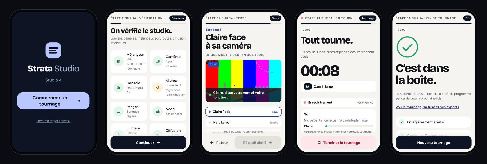
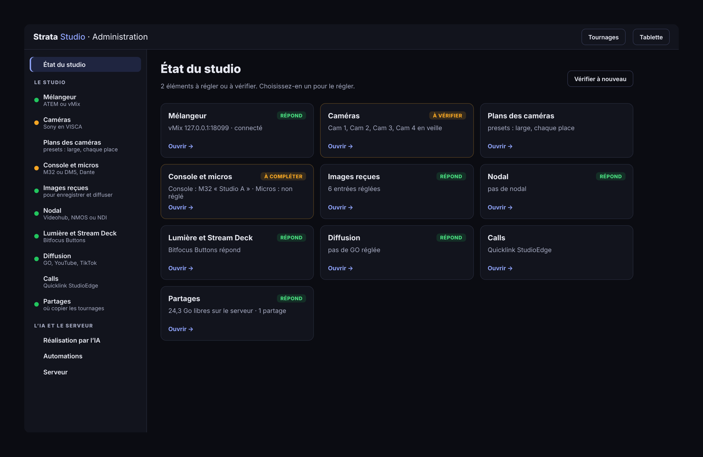
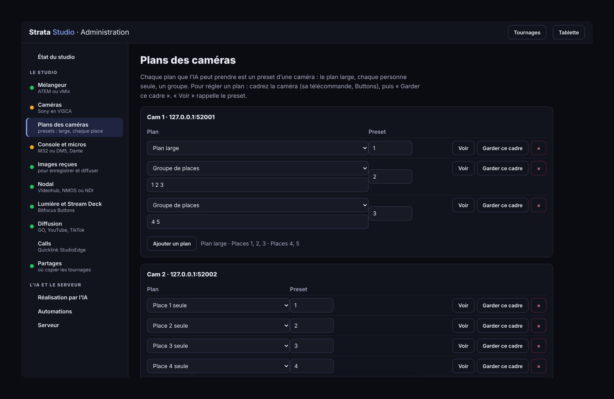
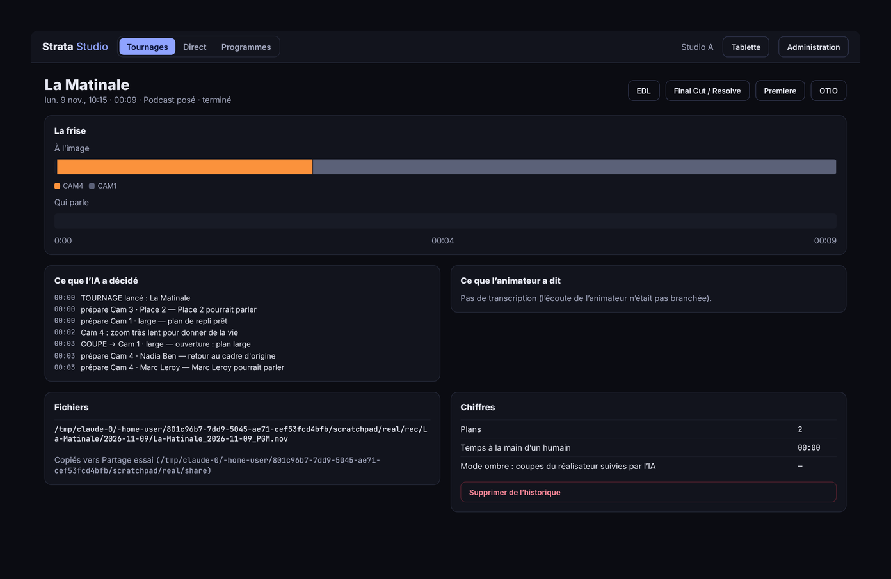

# Strata Studio

**Le studio autonome.** Strata Studio automatise un studio de podcast ou de radio filmée. Un journaliste prépare et lance son émission depuis une tablette, un téléphone ou un Stream Deck. Une IA locale réalise :

- elle commute le mélangeur (ATEM ou vMix) ;
- elle cadre les caméras PTZ (Sony FR7, BRC-AM7) ;
- elle écoute l'animateur pour anticiper un call ou un duplex.

Un réalisateur reprend la main quand il veut, au pupitre ou à la console.

Studio enregistre jusqu'à 6 canaux en 4:2:2 et un WAV par micro, fabrique les versions 9:16 et copie le tout sur un partage SMB. Il lance la diffusion sur la plateforme GO choisie (un Blackmagic Streaming Encoder par GO), sur YouTube et sur TikTok en 9:16. Il pilote :

- le nodal : Videohub, NMOS IS-05 ou NDI ;
- la console : Midas M32 ou Yamaha DM5 ;
- les calls : Quicklink StudioEdge ;
- la lumière et les automations : Bitfocus Buttons.

Strata Studio fait partie de la galaxie Strata, avec Strata Graphics et Strata Multiview.

> **État.** Studio pilote les vrais appareils qu'on lui règle ; il ne simule rien. Un appareil non réglé est signalé « non réglé », et un appareil qui ne répond pas, « ne répond pas ». Tout le parcours a été essayé de bout en bout contre des appareils qui parlent les vrais protocoles (vMix, caméras VISCA, M32, Buttons), mais **pas encore sur le vrai matériel**. La liste est en bas de page, à la section [À valider sur le matériel](#à-valider-sur-le-matériel). Les fonctionnalités sont décrites dans [`docs/FONCTIONNALITES.md`](docs/FONCTIONNALITES.md).

## Aperçu

Les captures viennent du programme, réglé sur un vMix, quatre caméras VISCA, une M32 et Buttons.

**Le tournage au téléphone** : l'accueil, la vérification des appareils (chacun interrogé), les tests (sans micros Dante, on valide à l'oreille), le tournage, la fin.



**L'administration** s'ouvre sur l'état du studio : chaque appareil, ce qu'il répond, ce qui reste à régler.



Chaque appareil a sa page. Ici les plans des caméras : cadrer, puis « Garder ce cadre ».



**Un tournage** : la frise des plans, ce que l'IA a décidé, les fichiers et les exports de montage.



## Installer sur Ubuntu

Pour Ubuntu Server **22.04 LTS** ou **24.04 LTS**, en 64 bits (amd64). Partez d'une installation minimale d'Ubuntu Server, avec une adresse fixe sur le réseau de la régie.

### L'installateur pas à pas

```bash
curl -fsSLO https://github.com/DamienP2/Strata-Studio/releases/latest/download/install.sh
```

```bash
sudo bash install.sh
```

L'installateur pose ses questions dans des fenêtres. Ce qu'on laisse vide (« Plus tard ») reste non réglé et se règle ensuite dans l'administration. Il déroule 14 étapes :

1. **La machine** : la version d'Ubuntu, la place libre.
2. **Les paquets** : ffmpeg, cifs-utils (partages SMB), python3, curl, whiptail, et la mise à jour du système si on la demande.
3. **Strata Studio** : la dernière release, vérifiée par sa somme SHA-256, avec son service systemd.
4. **Le studio** : son nom.
5. **Le mélangeur et la console** : ATEM ou vMix et ses mises en page, M32 ou DM5, et leurs adresses.
6. **Les caméras** : VISCA over IP et l'adresse de chaque caméra.
7. **Le nodal** : Videohub, NMOS IS-05 ou NDI. Il propose d'installer le runtime NDI 6, ce qui vaut acceptation de la licence NDI.
8. **Les micros** : le fichier SDP du flux AES67 (Dante) et la carte réseau. En option, l'écoute de l'animateur : whisper.cpp compilé sur la machine, son modèle et son service.
9. **Bitfocus Buttons** : l'adresse, et le Stream Deck.
10. **Les images reçues** : images de test, SRT ou RTP, ou cartes DeckLink. Le ffmpeg d'Ubuntu ne gère pas DeckLink : il faut alors un ffmpeg compilé avec DeckLink. Puis le codec et le conteneur.
11. **La carte graphique** : le pilote NVIDIA ou Quick Sync, et l'encodeur à utiliser.
12. **La diffusion** : les encodeurs des GO, les clés YouTube et TikTok, Quicklink.
13. **Les partages** : chaque partage SMB, avec son compte (gardé dans un fichier lisible par root seul), monté au démarrage.
14. **Le pare-feu et le démarrage** : les ports ouverts si ufw est actif, Studio démarré, les adresses à ouvrir affichées.

On peut relancer l'installateur quand on veut : il reprend les réglages en place. Pour l'automatiser :

- `--yes` installe Studio sans poser de question ; les appareils se règlent ensuite dans l'administration ;
- `--answers fichier` lit les réponses dans un fichier `cle=valeur` (les clés figurent dans `packaging/install.sh`).

Le journal de l'installation est dans `/var/log/strata-studio-install.log`.

### Ce qui est installé

| Où | Quoi |
| --- | --- |
| `/usr/bin/strata-studio` | le serveur : pages, API, IA, enregistrement |
| `/usr/bin/banc-encodage` | mesure combien de canaux 4:2:2 la machine encode en temps réel |
| `strata-studio.service` | le service systemd, lancé au démarrage, relancé s'il s'arrête |
| `/var/lib/strata-studio/reglages.json` | les réglages : appareils, programmes, profils de l'IA, automations |
| `/var/lib/strata-studio/tournages/` | l'historique des tournages, gardé même après désinstallation |
| `/var/lib/strata-studio/enregistrements/` | les enregistrements, avant leur copie sur le partage |
| `/etc/strata-studio/strata-studio.env` | l'adresse d'écoute, le dossier, des options |

### Ouvrir Studio

Depuis n'importe quel appareil du réseau de la régie (`<serveur>` est l'adresse du serveur) :

| Adresse | Pour qui |
| --- | --- |
| `http://<serveur>:8095/` | le journaliste : le parcours, sur la tablette ou le téléphone (à ajouter à l'écran d'accueil) |
| `http://<serveur>:8095/ecran` | l'écran du plateau |
| `http://<serveur>:8095/deck` | le Stream Deck à l'écran (les mêmes touches que le vrai) |
| `http://<serveur>:8095/tournages` | les tournages, leurs fichiers et leurs exports de montage |
| `http://<serveur>:8095/direct` | suivre le direct, reprendre ou rendre la main |
| `http://<serveur>:8095/programmes` | les émissions et leurs réglages |
| `http://<serveur>:8095/admin` | l'administration : l'état de chaque appareil, et une page pour régler chacun |

Les pages, les polices et les bibliothèques sont dans le serveur : rien n'est chargé depuis Internet au studio.

### Le Stream Deck +

Le Stream Deck se branche sur Bitfocus Buttons, et Studio remplit ses touches. Dans Système, réglez l'adresse de Buttons et cochez « écrire les touches du Stream Deck ». Studio écrit alors dans les variables de Buttons :

- `studio_deck_title` et `studio_deck_hint` : le titre et la consigne ;
- `studio_k1` à `studio_k8` : le texte des 8 touches ;
- `studio_k1_on` à `studio_k8_on` : l'état de chaque touche (`1` choisi, `0`, `x` indisponible) ;
- `studio_d1` à `studio_d4` : les 4 molettes.

Dans Buttons :

- chaque touche affiche `$(custom:studio_k1)` et envoie une requête HTTP `POST http://<serveur>:8095/api/deck/key/1` ;
- chaque molette envoie `POST …/api/deck/dial/1/1` vers la droite et `…/dial/1/-1` vers la gauche.

Les touches 7 et 8 sont toujours « Retour » et « Valider ». Pour lancer ou terminer, on appuie deux fois : la première pression arme, la seconde agit.

### Au quotidien

```bash
journalctl -u strata-studio -f
```

```bash
sudo systemctl restart strata-studio
```

Pour mettre à jour, relancez `install.sh` : il installe la dernière release et garde les réglages. Sans l'installateur, installez le `.deb` de la release :

```bash
sudo apt install ./strata-studio_0.2.0_amd64.deb
```

Pour désinstaller (les tournages restent dans `/var/lib/strata-studio`) :

```bash
sudo apt remove strata-studio
```

## Régler le studio

Ouvrez `http://<serveur>:8095/admin`. La page **État du studio** interroge chaque appareil et dit, pour chacun : **répond**, **à vérifier**, **ne répond pas** ou **non réglé**. Chaque appareil a sa page dans la colonne de gauche, avec une explication et un formulaire court. « Enregistrer et appliquer » enregistre, redémarre Studio si un appareil a changé, puis vérifie à nouveau.

Dans l'ordre :

1. **Mélangeur** : ATEM ou vMix, et son adresse. C'est le seul appareil indispensable pour tourner.
2. **Caméras** : l'adresse de chaque caméra et son entrée sur le mélangeur. Les boutons « Allumer » et « Veille » permettent de vérifier tout de suite.
3. **Plans des caméras** : pour chaque plan (large, chaque place), cadrez la caméra, puis « Garder ce cadre » enregistre le preset ; « Voir » le rappelle.
4. **Console et micros** : la console, le flux Dante (fichier SDP exporté depuis Dante Controller), et la tranche et le canal de chaque place. Sans les micros, l'IA ne sait pas qui parle et garde le plan large ; les tests se font alors à l'oreille.
5. **Images reçues** : d'où arrivent le PGM, le CLEAN et chaque caméra (SRT, RTP ou DeckLink), pour enregistrer et diffuser.
6. Selon le studio : **Nodal**, **Lumière et Stream Deck**, **Diffusion**, **Calls**, **Partages**.

L'IA ne touche au studio que pendant un tournage. Hors tournage, rien n'est envoyé au mélangeur, aux caméras ni à la console.

Pour lancer Studio depuis les sources, avec Rust (par [rustup](https://rustup.rs)) et ffmpeg :

```bash
cargo run -p strata-studio-server -- --data ./donnees
```

Les options de la ligne de commande passent avant les réglages, par exemple `--atem 192.168.10.2`, `--console m32:192.168.10.4` ou `--buttons 192.168.10.5:8000` (voir `strata-studio --help`).

## L'API

Les pages utilisent la même API que le Stream Deck et les automations.

| Route | |
| --- | --- |
| `GET /api/live` | l'état complet, quatre fois par seconde (Server-Sent Events) ; `GET /api/snapshot` une fois |
| `POST /api/session/start`, `/next`, `/prev`, `/goto/{étape}`, `/reset` | le parcours |
| `POST /api/session/draft` | changer des réponses (`{"people": 3, "go": 1}`) |
| `POST /api/session/programme/{i}` | reprendre les réglages d'un programme |
| `POST /api/session/test/ok`, `/test/retry` | les tests |
| `POST /api/session/launch`, `/end` | lancer, terminer le tournage |
| `POST /api/control/auto`, `/shadow`, `/take?by=…` | l'IA a la main, l'IA en ombre, une personne prend la main |
| `GET /api/tournages`, `/api/tournages/{id}` | les tournages |
| `GET /api/tournages/{id}/export/{edl,fcpxml,xml,otio}` | le montage |
| `POST /api/tournages/{id}/replay` | l'IA rejouée sur un tournage avec un autre profil |
| `GET`, `PUT /api/settings` ; `PUT /api/programmes`, `/api/profiles`, `/api/scenarios` | les réglages |
| `POST /api/scenarios/plan/{événement}`, `/run/{événement}` | ce qu'une automation déclencherait, ou la lancer |
| `POST /api/deck/key/{n}`, `/api/deck/dial/{n}/{±1}` | le Stream Deck |
| `GET /api/preview/{CAM1…, PGM}` | l'image d'une source (MJPEG) |
| `GET /api/system`, `POST /api/system/restart` | le serveur |

## Code

| Crate | Rôle |
| --- | --- |
| `strata-studio-core` | le studio, la perception, les profils, le **Réalisateur** (une fonction pure, testée sur des conversations écrites) et l'**écoute** de l'animateur |
| `strata-studio-devices` | les appareils (un appareil non réglé est « absent » ; des simulateurs servent aux seuls tests) : ATEM (UDP 9910), vMix (TCP 8099), Videohub, NMOS IS-05, NDI (runtime chargé au démarrage), caméras VISCA, M32 (OSC), DM5 (RCP), Bitfocus Buttons, Blackmagic Streaming Encoder (REST), Quicklink (REST v1.5) |
| `strata-studio-sense` | les micros en AES67 et qui parle ; l'oreille de l'animateur avec whisper.cpp |
| `strata-studio-media` | l'enregistrement 4:2:2, les WAV, le 9:16, la copie, YouTube et TikTok, les aperçus, les exports de montage |
| `strata-studio-bench` | `banc-encodage` |
| `strata-studio-server` | l'exécutable `strata-studio` : réglages, parcours partagé, tournages, automations, Stream Deck, pages web (dans `web/`) |

```bash
cargo test --workspace
```

```bash
cargo clippy --workspace --all-targets -- -D warnings
```

### Construire le paquet et publier une release

```bash
packaging/build-deb.sh
```

Le paquet `.deb`, l'archive des exécutables, `install.sh` et leurs sommes SHA-256 sont dans `dist/`. Le workflow `.github/workflows/release.yml` publie une release :

- par une étiquette `vX.Y.Z` ;
- ou à la main, depuis l'onglet **Actions**, avec le numéro de version.

Il passe les essais, construit le paquet sur Ubuntu 22.04, l'installe, vérifie que le service répond, puis attache les fichiers à la release.

## À valider sur le matériel

Le code suit la documentation de chaque constructeur, mais ces points n'ont été essayés que contre de faux appareils parlant leurs protocoles :

- la SuperSource de l'ATEM (50/50, vignette) et les mises en page de vMix ;
- la console DM5 (RCP), l'API HTTP de Bitfocus Buttons et les variables du Stream Deck ;
- les caméras Sony en VISCA over IP ;
- le Blackmagic Streaming Encoder 4K et l'API Quicklink, dont l'adresse est propre à chaque compte ;
- les correspondances entre les positions de StudioEdge et les entrées du mélangeur ;
- NMOS IS-05 et NDI, sans appareil ni runtime NDI ici ;
- whisper.cpp et sa compilation par l'installateur ;
- l'encodage sur la machine retenue : lancer `banc-encodage`.

Un point n'est pas codé : le **suivi des visages** (recadrer quand un invité se penche). Il demande une analyse de l'image, ou l'auto-cadrage des caméras Sony.
